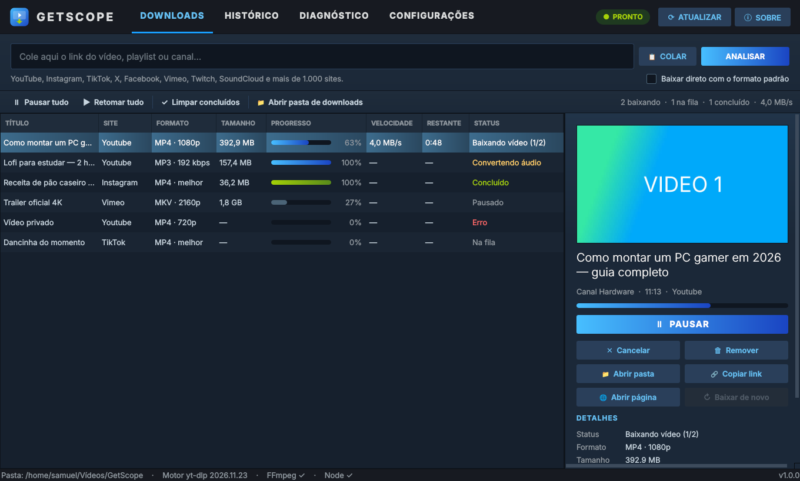
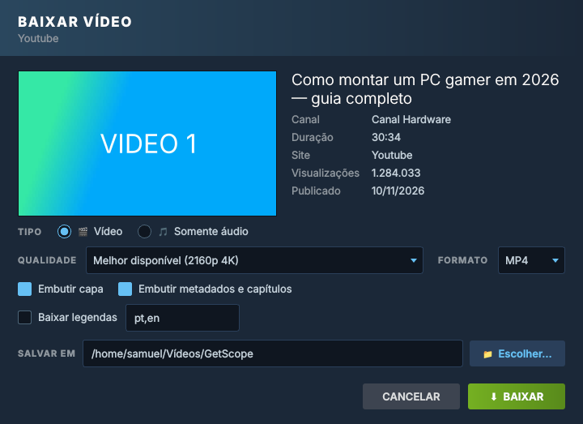
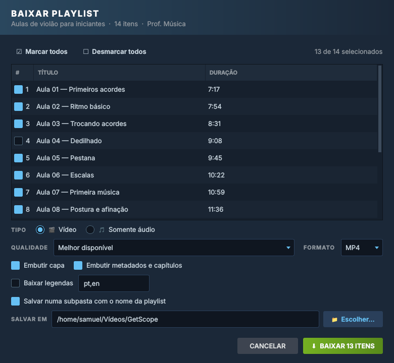
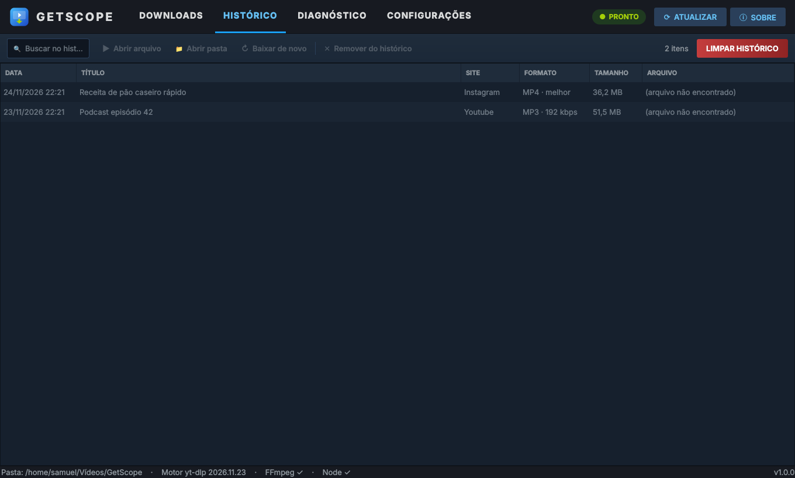
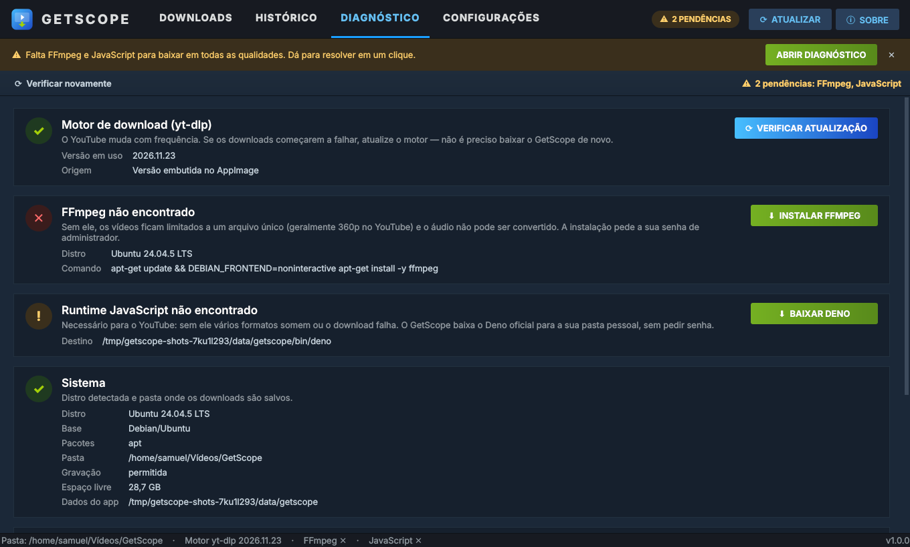
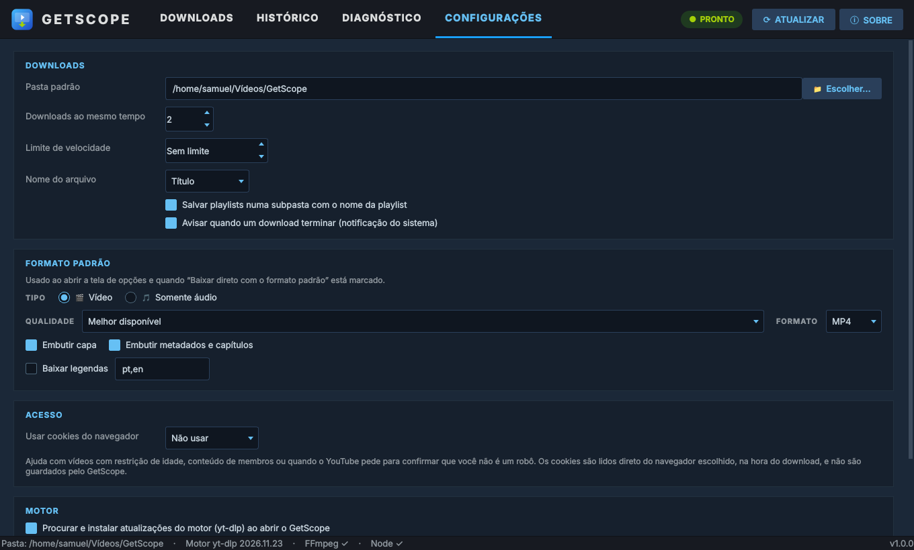
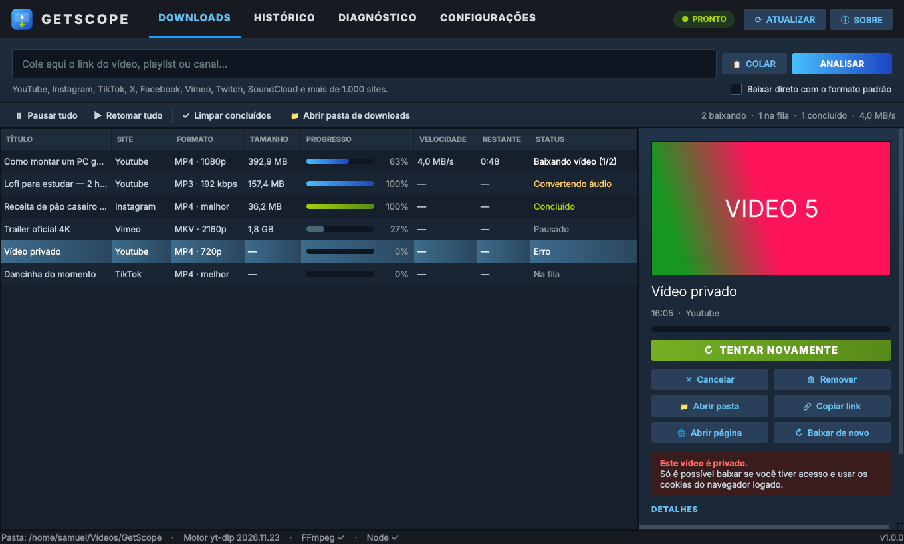
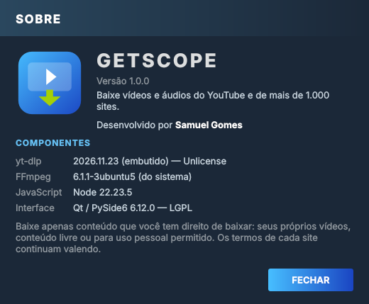

# GetScope

Baixe vídeos e áudios do YouTube e de mais de 1.000 sites (Instagram, TikTok, X, Facebook, Vimeo, Twitch, SoundCloud…), em um AppImage para Linux. Usa o [yt-dlp](https://github.com/yt-dlp/yt-dlp) como motor.

Desenvolvido por **Samuel Gomes**.



## Capturas

| Baixar vídeo | Baixar playlist |
|---|---|
|  |  |
| Prévia com miniatura, canal e duração; qualidade com o tamanho estimado, ou só o áudio. | Marque os itens, escolha vídeo ou só áudio para a playlist inteira e salve numa subpasta. |

| Histórico | Diagnóstico |
|---|---|
|  |  |
| Busca, abrir arquivo ou pasta e baixar de novo. | Atualiza o motor e instala FFmpeg e Deno com um clique. |

| Configurações | Erro com dica de solução |
|---|---|
|  |  |
| Pasta, formato padrão, limite de velocidade e cookies do navegador. | Mensagens em português explicando o que fazer. |

<p align="center"></p>

> As miniaturas das capturas são imagens de exemplo; no app aparece a capa de cada vídeo.

## Funções

- **Downloads:** cole o link (ou arraste para a janela) e veja a prévia com miniatura, canal e duração.
- **Vídeo:** do 144p ao 8K, com o tamanho estimado de cada qualidade, em MP4, MKV ou WEBM.
- **Áudio:** MP3, M4A, OPUS, FLAC ou WAV, de 128 a 320 kbps.
- **Extras:** capa, metadados, capítulos e legendas embutidos no arquivo.
- **Playlists e canais:** marque os vídeos que quer e salve numa subpasta com o nome da playlist.
- **Fila:** vários downloads ao mesmo tempo. Dá para pausar, retomar de onde parou, cancelar (apaga os temporários) e tentar novamente.
- **Sessão:** downloads em andamento são guardados ao fechar e retomados depois.
- **Histórico:** busca, abrir arquivo ou pasta e baixar de novo.
- **Diagnóstico:**
  - **Motor (yt-dlp):** atualiza sem gerar o AppImage de novo. O arquivo é conferido pelo SHA-256 antes de ser instalado.
  - **FFmpeg:** instala pelo gerenciador da distro (Arch, Debian/Ubuntu, Fedora ou openSUSE).
  - **Deno:** baixado para a pasta pessoal, sem senha. É o runtime JavaScript que o YouTube exige.
  - **Registro:** mostra os erros.
- **Configurações:**
  - pasta e formato padrão;
  - limite de velocidade e modelo de nome do arquivo;
  - cookies do navegador, para vídeos com restrição de idade ou quando o YouTube pede para confirmar que você não é um robô.
- **Erros:** mensagens em português, com a dica de como resolver.

## Estrutura

```
getscope/core/    motor (yt-dlp), fila, histórico, dependências, rede — sem interface
getscope/ui/      janela, abas e diálogos
scopekit/         tema e componentes visuais compartilhados com os outros apps *Scope
tests/            testes automáticos (python3 -m pytest)
tools/            screenshots.py (gera as capturas de docs/img com dados simulados)
docs/img/         capturas usadas neste README
build.sh          gera o AppImage
```

## Como o motor atualizado funciona

O AppImage traz uma versão do yt-dlp embutida. **Diagnóstico › Verificar atualização** baixa o executável oficial "zipimport" do yt-dlp para `~/.local/share/getscope/engine/yt-dlp.zip`. Ele já inclui o yt-dlp-ejs. Na próxima abertura, se essa cópia for mais nova que a embutida, o app usa ela. **Voltar para a embutida** apaga a cópia.

## Gerar o AppImage

```bash
pip install PySide6-Essentials pyinstaller "yt-dlp[default]"
./build.sh                      # precisa do appimagetool no PATH (ou APPIMAGETOOL=...)
```

Diagnóstico sem interface:

```bash
./GetScope-*.AppImage --engine-info
./GetScope-*.AppImage --selftest URL PASTA
```

## Aviso

Baixe apenas conteúdo que você tem direito de baixar. Os termos de cada site continuam valendo.
